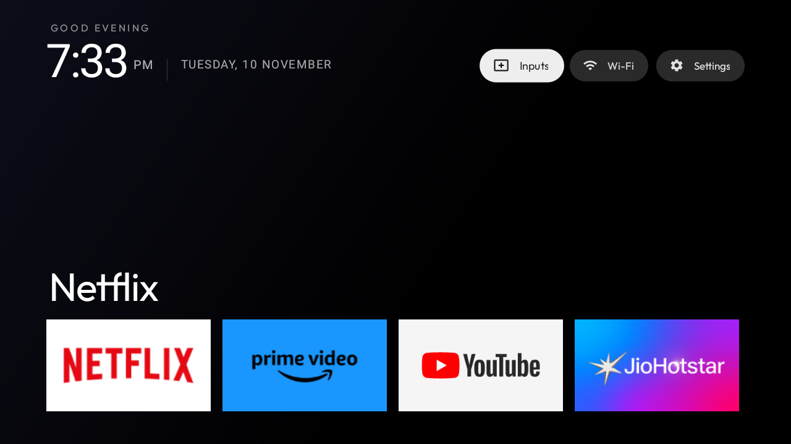

<div align="center">

# OpenTV

**A clean, distraction-free home screen for Android TV.**

No ads. No recommendation feed. No telemetry. Just your apps, a clock, and the
thing you actually wanted to watch.

[](LICENSE)
[](https://developer.android.com/tv)
[](https://developer.android.com)
[](https://developer.android.com)
[](app/src/main/java)
[](https://github.com/titanxdevz/OpenTV/actions/workflows/ci.yml)
[](https://github.com/titanxdevz/OpenTV/actions/workflows/codeql.yml)
[](https://github.com/titanxdevz/OpenTV)

</div>

---

## Preview

<div align="center">
  
</div>

Focusing an app re-themes the entire screen: the sky gradient, the ambient
glow and the cinematic backdrop are all derived from that app's own artwork.

---

## Why OpenTV

Stock Android TV launchers are built to monetise your attention. Google TV
ships a recommendations row, a sponsored app shelf, and background telemetry
to support both. OpenTV replaces all of it with one screen and nothing else.

| | Stock Google TV | OpenTV |
|---|---|---|
| Ads and sponsored shelves | Yes | None |
| Recommendations feed | Yes | None |
| Background telemetry | Yes | None |
| Network permission | Often | Not requested |
| App start-up | Slow — several background services | Fast — single Activity, no services |
| Memory footprint | ~200 MB | ~60 MB |

OpenTV is one `Activity`, a `RecyclerView` and a handful of custom `View`s.
There is no background service, no `WorkManager`, no analytics SDK, and no
`INTERNET` permission in the manifest.

---

## Features

**Adaptive home screen**

- Time-of-day sky gradient with a live clock and a contextual greeting
  (Good Morning / Afternoon / Evening / Night), refreshed every minute.
- The focused app's artwork is palette-sampled; its accent colour drives a
  soft radial ambient glow blended into the sky.
- The focused app's banner is blurred and stretched full-screen as a subtle
  cinematic backdrop behind the interface.
- Hero title cross-fades to the name of the focused app.

**Motion**

- A custom `GlassView` overlay springs between tiles with an overshoot curve.
- Pressing OK on a tile zooms that tile to full-screen while the app opens.
- Custom scroll physics for the app row, with a slim position indicator.

**Device integration**

- Hardware input switcher (HDMI, tuner) built on `TvInputManager`.
- Live Wi-Fi status and SSID, shown in-app.
- A slide-in settings panel for Wi-Fi, inputs, display and system settings.

**Engineering**

- Full D-pad navigation, with focus state preserved across app switches,
  rotation and relaunch.
- Glide disk-caches all artwork, so the second boot is instant.
- Artwork decoded as `RGB_565` and downscaled — tuned for 1 GB RAM TVs.
- Banners are used where available, icons as a fallback.

---

## Getting started

### Requirements

| Tool | Version |
|---|---|
| JDK | 17 |
| Android SDK platform | 34 (`compileSdk`) |
| Gradle | 8.4 (wrapper included) |
| Minimum device | Android 8.0 (API 26) |

### Clone and build

```bash
git clone https://github.com/titanxdevz/OpenTV.git
cd OpenTV
```

Point Gradle at your SDK by creating `local.properties` in the project root.
It is deliberately git-ignored, so it never leaks a machine-specific path.

```properties
sdk.dir=/path/to/Android/sdk
```

Then build:

```bash
# macOS / Linux
chmod +x gradlew
./gradlew assembleDebug

# Windows
gradlew.bat assembleDebug
```

The APK is written to `app/build/outputs/apk/debug/app-debug.apk`.

---

## Installing on a TV

### Enabling ADB over the network

Most Android TVs expose **ADB over USB only**, with no network option in
Developer Options. Two common ways around it:

1. Some Android TV 11 builds include **ADB over Wi-Fi** under
   Developer Options.
2. A third-party **ADB TV** / **ADB Connect** app from the Play Store opens a
   small HTTP page on the TV and enables port `5555`.

### Connect and install

```bash
adb connect <TV_IP>:5555
adb devices -l          # expect: device product:DVB91RM

adb push app/build/outputs/apk/debug/app-debug.apk /data/local/tmp/opentv.apk
adb shell pm install -r /data/local/tmp/opentv.apk
adb shell input keyevent KEYCODE_HOME
```

OpenTV registers as the `HOME` activity, so the Home key now opens it.

### Reverting to the stock launcher

```bash
adb shell pm uninstall com.clean.launcher
```

---

## How it works

```
app/src/main/java/com/clean/launcher/
├── MainActivity.java            Entry point — app discovery, D-pad routing, focus restore
├── AppInfo.java                 App record (package, label, icon, banner, cached backdrop)
├── AppRowAdapter.java           Row adapter — Glide loading, palette sampling, blur generation
├── SkyView.java                 Time-of-day gradient background
├── AmbientView.java             Soft radial accent glow
├── GlassView.java               Spring-animated floating focus highlight
├── LaunchAnimator.java          Zoom-to-fullscreen app launch
├── RowIndicatorView.java        Slim scroll-position indicator
├── SmoothRowLayoutManager.java  Custom scroll physics for the app row
├── InputsDropdown.java          Hardware input picker
└── SettingsPopup.java           Slide-in settings overlay
```

### The focus pipeline

Focus has to feel instant, but colour sampling and blur generation are
expensive. The pipeline separates the two by cost:

```
focus event
   ├── hero title cross-fade         synchronous, ~80 ms
   ├── GlassView springs to tile     synchronous
   └── palette thread
        ├── sample accent colour  ──▶ AmbientView + SkyView blend
        └── blur banner            ──▶ full-screen cinematic backdrop
```

Hero name and focus highlight never wait on the palette thread. Accent colour
and backdrop arrive a few milliseconds later and cross-fade in.

### Memory constraints

The target hardware has roughly 1 GB of RAM. Artwork is therefore decoded at
reduced dimensions with `RGB_565` — half the memory of `ARGB_8888` — and
cached to disk by Glide. Backdrops are generated by downscaling to 28×16 and
upscaling with bilinear filtering, which is a cheap and smooth approximation
of a blur.

---

## Dependencies

| Library | Version | Purpose |
|---|---|---|
| `androidx.appcompat` | 1.6.1 | Activity and theming |
| `androidx.recyclerview` | 1.3.2 | App row and settings lists |
| `androidx.palette` | 1.0.0 | Accent colour extraction |
| `androidx.constraintlayout` | 2.1.4 | Layout constraints |
| `com.github.bumptech.glide` | 4.16.0 | Image loading and disk cache |

All are pinned to exact versions.

---

## Project status

<div align="center">

[](https://github.com/titanxdevz/OpenTV/stargazers)
[](https://github.com/titanxdevz/OpenTV/network/members)
[](https://github.com/titanxdevz/OpenTV/graphs/contributors)
[](https://github.com/titanxdevz/OpenTV/issues)
[](LICENSE)

</div>

### Star history

[](https://star-history.com/#titanxdevz/OpenTV&Date)

---

## Contributing

Contributions are welcome. See [CONTRIBUTING.md](CONTRIBUTING.md) for the
workflow, commit conventions and the review checklist.

Before opening a pull request, please make sure `./gradlew :app:lintDebug`
passes and fill in the [pull request template](.github/pull_request_template.md).

### Continuous integration

Every push and pull request runs:

| Workflow | Purpose |
|---|---|
| [CI](.github/workflows/ci.yml) | Compile, unit test, Android Lint, assemble |
| [CodeQL](.github/workflows/codeql.yml) | Static analysis for Java |
| [Gitleaks](.github/workflows/ci.yml) | Secret detection |
| [OWASP Dependency-Check](.github/workflows/ci.yml) | Dependency CVE scan |
| [Trivy](.github/workflows/ci.yml) | Filesystem misconfiguration and secret scan |
| [Dependency Review](.github/workflows/ci.yml) | Licence and CVE review of dependency changes |
| [Manifest policy](.github/workflows/ci.yml) | Blocks new permissions and cleartext traffic |
| [Scorecard](.github/workflows/scorecard.yml) | OpenSSF supply-chain security rating |

[Dependabot](.github/dependabot.yml) keeps Gradle, Actions and Android
dependencies up to date.

---

## Security

Please do not report vulnerabilities in a public issue. Follow the private
reporting process in [SECURITY.md](.github/SECURITY.md).

OpenTV requests only `ACCESS_NETWORK_STATE` and `ACCESS_WIFI_STATE`. It has no
`INTERNET` permission and never makes a network request.

---

## License

OpenTV is open source software released under the [MIT License](LICENSE).

```
MIT License
Copyright (c) 2026 titanxdevz
```

You are free to use, copy, modify, merge, publish, distribute, sublicense and
sell copies of the software, for commercial or non-commercial purposes, under
the conditions of the MIT License.

This project is not affiliated with, endorsed by, or sponsored by Google,
Netflix, Amazon, or any other vendor whose trademarks or icons it displays.
App icons and banners belong to their respective owners and are loaded at
runtime by the system.

---

## Acknowledgements

Inspired by [CleanYourTV](https://github.com/Gathin23/cleanyourtv) by
Gathin23, and by the design language of the Apple TV 4K home screen.

---

## Author

**titanxdevz** — <inkmcontop@gmail.com>
